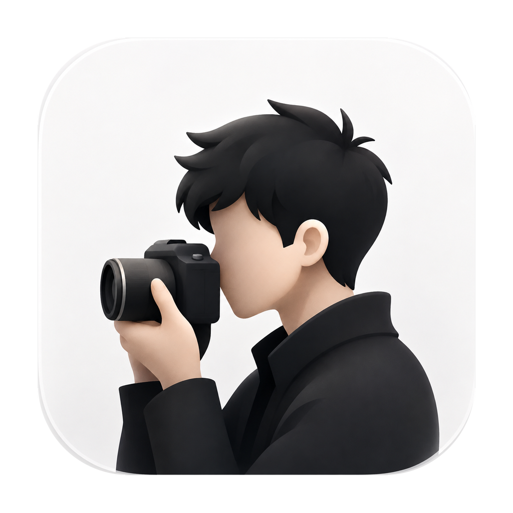

<p align="center">
  
</p>

<h1 align="center">DogSC · Windows 社区移植版</h1>

<p align="center">录下操作，把重点交给画面。</p>

<p align="center">
  <a href="https://github.com/lantiansb/dogsc/releases/tag/v0.2.17-windows-beta.1"><strong>下载 Windows 版</strong></a>
  · <a href="docs/user-guide.md">使用指南</a>
  · <a href="https://github.com/lantiansb/dogsc/issues">反馈与建议</a>
  · <a href="https://github.com/laogou717/dogsc">DogSC 原项目</a>
  · <a href="https://github.com/laogou717/dogsc/releases/latest">macOS 版下载</a>
</p>

DogSC 把录屏、剪辑、运镜与导出放在同一个桌面应用里。录下软件操作后，你可以剪去停顿、放大重点，再配上背景、光标反馈和口播，做成教程、产品演示或功能介绍。

我希望 Windows 用户也能用 DogSC 做出清楚、好看的屏幕演示。这个社区移植版由 **lantiansb** 维护，基于 **神烦老狗** 的 [DogSC](https://github.com/laogou717/dogsc) 开源项目，延续原版的名称、图标与设计，并结合 Windows 的录制接口、托盘和桌面操作习惯持续打磨。

## 下载 Windows Beta

**DogSC 0.2.17 · Windows 11 x64 · 社区测试版**

| 下载 | 用法 |
|---|---|
| **[下载安装器（EXE）](https://github.com/lantiansb/dogsc/releases/download/v0.2.17-windows-beta.1/DogSC-Setup-0.2.17-win-x64.exe)** | 安装到当前用户，创建开始菜单入口。 |
| **[下载便携版（ZIP）](https://github.com/lantiansb/dogsc/releases/download/v0.2.17-windows-beta.1/DogSC-0.2.17-win-x64.zip)** | 完整解压后运行 `app/DogSC.exe`。 |
| [下载源码（含原 DogSC 快照）](https://github.com/lantiansb/dogsc/releases/download/v0.2.17-windows-beta.1/DogSC-0.2.17-source.zip) | 开发与自行构建。 |
| [SHA-256 校验文件](https://github.com/lantiansb/dogsc/releases/download/v0.2.17-windows-beta.1/DogSC-0.2.17-SHA256SUMS.txt) | 核对下载文件完整性。 |

安装包已包含 .NET 和 FFmpeg。录制需要系统具备 [Microsoft Visual C++ x64 运行库](https://aka.ms/vc14/vc_redist.x64.exe)；若安装器提示缺少运行库，按提示安装即可。当前 Beta 使用未签名构建，首次运行时 Windows 可能显示发布者验证提示。

## 用 DogSC 做一段演示

- **选好范围，开始录制。** 支持显示器、窗口和区域录制，按需加入系统声音与麦克风。录制中可以暂停、继续，也可以添加标记，方便回来剪辑。
- **把观看节奏剪出来。** 在多轨时间线上裁短、分割、重排和变速；点击定位画面，悬停时保留当前帧，方便逐段检查。
- **让画面跟着重点走。** 用自动或手动缩放引导视线，配合屏幕 3D、聚焦虚化和光标点击反馈，突出要讲解的操作。
- **为演示挑一套外观。** 调整比例、留白、圆角、阴影和背景，选择窗口或设备样机，将常用搭配保存为场景预设。
- **边讲边录，文稿就在眼前。** 独立口播提词器支持自动滚动、调速、字号和背景透明度，保存文稿与窗口位置。录制浮窗独立于编辑器，托盘随时唤回。
- **保存工程，导出成片。** 编辑自动保存并保留备份；完成后导出 MP4 视频或 M4A 音频，也可以只导出选定范围。

## 第一次使用

1. **打开 DogSC。** 安装版从开始菜单启动；便携版完整解压后运行 `app/DogSC.exe`，桌面会出现录制浮窗。
2. **录下操作。** 选择显示器、窗口或区域，按需打开系统声音和麦克风，开始录制。停止后进入编辑器。
3. **剪辑并导出。** 在时间线上去掉多余片段，调整运镜与画面外观，点击右上角“导出”生成成片。

想先试试编辑器，可以打开随包的 `samples/FrameTrail-Demo/FrameTrail-Demo.frametrail`；同目录的 MP4 是导出样片。更多操作与快捷键见[使用指南](docs/user-guide.md)。

关闭主编辑器后，DogSC 会留在托盘，录制浮窗继续可用。需要结束应用时，从托盘菜单选择“退出 DogSC”。

## 版本进展与反馈

**0.2.17 是首个 Windows Beta。** 本次发布已在 Windows 11 x64 上完成录制、暂停、剪辑、工程重开、导出、安装与卸载的完整流程验证，源码包也通过独立构建。

接下来会重点打磨摄像头、多设备、多显示器与混合 DPI，以及长时间录制的稳定性。这些场景仍在扩展验证中，当前覆盖情况见[版本说明](docs/release-0.2.17.md)。新版本通过 [Releases](https://github.com/lantiansb/dogsc/releases) 下载更新。

欢迎在 [Issues](https://github.com/lantiansb/dogsc/issues) 分享使用感受、复现步骤和功能建议。反馈时带上版本、Windows 版本和设备信息，能帮助我更快定位问题。

## 参与开发

开发环境使用 Windows 11 x64、.NET 10 SDK、PowerShell 7 和 Windows Media Foundation。构建脚本自动下载并校验固定版本的媒体依赖：

```powershell
git clone --branch codex/windows --recurse-submodules https://github.com/lantiansb/dogsc.git
cd dogsc
git submodule update --init --recursive
pwsh -File scripts/build.ps1
```

Windows 开发分支为 `codex/windows`，`main` 保留原项目代码。欢迎提交改进和修复，具体流程见[贡献指南](CONTRIBUTING.md)与[构建与发行](docs/build-and-release.md)。历史开发记录见[开发历史](docs/development-history.md)。

## 致谢与许可

感谢 **神烦老狗** 创作并以 MIT 许可证开源 [DogSC](https://github.com/laogou717/dogsc)，让这个 Windows 移植版有了起点。应用沿用原项目名称、图标与 Logo，原项目及资产说明见 [DogSC MIT 许可](licenses/DogSC-MIT.txt)和[品牌资产来源](licenses/DogSC-ASSETS.md)。Windows 适配也参考了 [xiaoying8666/dogscwindows](https://github.com/xiaoying8666/dogscwindows)，相关署名与许可收录在[第三方通知](licenses/THIRD-PARTY-NOTICES.md)中。

媒体处理使用 FFmpeg：预览动态库采用 LGPL，独立编码程序采用 GPL。对应源码、依赖和构建脚本随包提供，也可[单独下载 FFmpeg 源码材料](https://github.com/lantiansb/dogsc/releases/download/v0.2.17-windows-beta.1/DogSC-FFmpeg-8.1.2-sources.zip)。详细配置与许可见 [FFmpeg 构建来源](third_party/ffmpeg/README.md)。

原 DogSC 以子模块保存在 `upstream/dogsc`，固定于 `e207d11b111c5e58152238fb64115b2009850547`；源码发行包包含这一上游快照。
